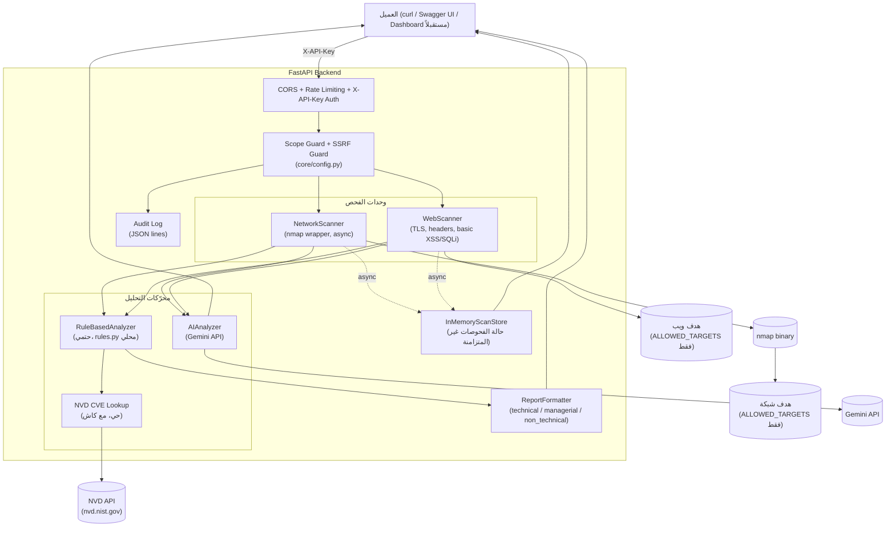

# AI-Powered Security Scanner (بالعربي)

مشروع تخرج جامعي: منصّة فحص أمني بالـ backend تفحص الشبكات (عبر `nmap`)
والمواقع (عبر `httpx`)، وتحلّل النتائج عبر محرّكين مستقلّين — محرّك AI
(Gemini) ومحرّك rule-based حتمي بالكامل — وتولّد تقارير حسب الجمهور
(تقني/إداري/غير تقني) من نفس الـ findings.

النسخة الإنجليزية الكاملة (المرجعية): [`README.md`](./README.md).

> **ملاحظة نطاق:** هذا مشروع بورتفوليو/تخرج يوضّح تصميم API آمن، مو بديل
> عن أدوات pentest احترافية (Burp Suite, sqlmap, OWASP ZAP, Nessus، إلخ).
> راجع قسم [الحدود](#الحدود) بالأسفل.

## المحتويات

- [البنية المعمارية](#البنية-المعمارية)
- [المزايا](#المزايا)
- [التشغيل السريع — Docker (موصى به)](#التشغيل-السريع--docker-موصى-به)
- [الواجهة الأمامية (داشبورد ثنائي اللغة)](#الواجهة-الأمامية-داشبورد-ثنائي-اللغة)
- [التشغيل السريع — venv محلي (بديل)](#التشغيل-السريع--venv-محلي-بديل)
- [Endpoints الـ API](#endpoints-الـ-api)
- [أمثلة طلبات](#أمثلة-طلبات)
- [اعتبارات أمنية (Security Considerations)](#اعتبارات-أمنية-security-considerations)
- [الاختبارات وCI](#الاختبارات-وci)
- [بنية المشروع](#بنية-المشروع)
- [الحدود](#الحدود)

## البنية المعمارية



**قرار تصميم — محرّكا تحليل مستقلّان:** محرّك AI (Gemini) يعطي تحليل عميق
وسياقي لكن غير حتمي ويكلّف استدعاء API بكل مرة. محرّك rule-based حتمي 100%،
مجاني، فوري، وقابل للتتبّع بالكامل (كل تصنيف يرجع لسطر كود واحد بـ
`rules.py`) — لكن يكتشف فقط ما هو مُبرمج له صراحة. `/analysis/compare`
يشغّل الاثنين معاً؛ لو AI فشل (مثلاً بدون مفتاح API)، تقرير rule-based
برجع دايماً.

## المزايا

- **فحص شبكات** — nmap wrapper غير متزامن (`basic` = أهم 1000 منفذ، `comprehensive`
  = كل الـ 65535)، يحوّل مخرجات XML لصيغة JSON موحّدة.
- **فحص مواقع** — فحص TLS/الشهادة، فحص Security Headers القياسية (CSP,
  HSTS, X-Frame-Options، إلخ)، وفحوصات أساسية لـ Reflected XSS وSQLi
  error-based (فقط لو الرابط فيه query parameters).
- **تحليل AI** — يبعث نتائج الفحص المُهيكلة لـ Gemini ويرجّع تقرير مرتّب
  الأولويات ومشروح.
- **تحليل rule-based** — محرّك بديل محلي بالكامل، حتمي؛ بدون API خارجي،
  بدون تكلفة، قابل للتتبّع بالكامل.
- **تقارير حسب الجمهور** — نفس الـ findings بثلاث صياغات (`technical`,
  `managerial`, `non_technical`) من مصدر حقيقة واحد (`rules.py`).
- **بحث CVE حي** — `POST /analysis/cve-lookup` يستعلم قاعدة بيانات NVD
  الحقيقية لمنتج/إصدار معيّن، مع كاش محلي.
- **فحوصات بالخلفية (background)** — `POST /*/scan/async` + `GET
  /scans/{id}/status` للفحوصات الطويلة (full scan)، عشان العميل ما ينحبس
  ينتظر دقايق.
- **أمان الـ API** — مصادقة `X-API-Key`، CORS، rate limiting لكل مفتاح،
  حماية SSRF مستقلة عن إعدادات النطاق، وaudit logging. راجع [اعتبارات
  أمنية](#اعتبارات-أمنية-security-considerations).

## التشغيل السريع — Docker (موصى به)

```bash
git clone <this-repo>
cd security-scanner

cp backend/.env.example backend/.env
# عدّل backend/.env: حط ALLOWED_TARGETS لأهداف lab خاصة فيك فقط،
# وحط API_KEY لقيمة سرية مولّدة (راجع التعليق بـ .env.example)

docker compose up --build
```

الـ API الآن على `http://localhost:8000` — توثيق تفاعلي على
`http://localhost:8000/docs`. الداشبورد على `http://localhost:5173`.

> **ملاحظة حول اختبار هذا الملف تحديداً:** بنيت إعداد Docker بعناية
> (تثبيت nmap، `setcap` لصلاحيات OS-detection عبر `-O`، مستخدم غير-root،
> healthcheck)، لكن بيئة التطوير اللي بنيت فيها هذا المشروع ما كان فيها
> Docker daemon متاح لتشغيل `docker compose up` end-to-end فعلياً.
> **تأكد إنه يشتغل صح ببيئتك أنت قبل ما تعتمد عليه بالكامل** — لو شي ما
> طلع صح، ابدأ بـ `docker compose logs backend`.

## الواجهة الأمامية (داشبورد ثنائي اللغة)

`frontend/` عبارة عن داشبورد React + TypeScript (Vite) لتشغيل الفحوصات
ومشاهدة تقارير التحليل بدون التعامل المباشر مع `curl`/Swagger. تتواصل مع
الـ backend عبر endpoints الموثّقة تحت.

- **واجهة وتقارير ثنائية اللغة:** كل endpoints التحليل تقبل حقل `language`
  (`"ar"` أو `"en"`، افتراضياً `"ar"`) يتحكم بلغة *محتوى التقرير المُولَّد*
  نفسه (عناوين findings، الشرح، remediation، الملخّص التنفيذي — بما فيه
  رد Gemini نفسه لمحرّك AI). التصنيف (severity) والمنطق متطابقان بكلتا
  اللغتين، يختلف فقط النص. واجهة الداشبورد نفسها (chrome) قابلة للتبديل
  بشكل مستقل عبر `frontend/src/i18n/`.
- تتواصل مع endpoints الـ backend المحمية بـ `X-API-Key` — حط
  `VITE_API_KEY` بملف `frontend/.env` لنفس قيمة `API_KEY` بالـ backend
  (راجع `frontend/.env.example`).

لتشغيلها منفردة (خارج Docker):

```bash
cd frontend
npm install
cp .env.example .env       # عدّل VITE_API_BASE_URL / VITE_API_KEY
npm run dev
```

بعدها افتح `http://127.0.0.1:5173` (تأكد إن الـ backend شغّال أولاً).

## التشغيل السريع — venv محلي (بديل)

### المتطلبات

- Python 3.11+
- nmap مثبّت على النظام (`sudo apt install nmap` على Ubuntu/Debian، أو
  `brew install nmap` على macOS)
- صلاحيات root/sudo لتفعيل OS fingerprinting (`-O`) بشكل كامل — بدونها
  الفحص يشتغل لكن `os_matches` ممكن يرجع فاضي

### الخطوات

```bash
cd backend
python3 -m venv venv
source venv/bin/activate          # على Windows: venv\Scripts\activate
pip install -r requirements.txt

cp .env.example .env
# عدّل ALLOWED_TARGETS وAPI_KEY بملف .env
# لا تضف أي هدف خارج بيئة lab خاصة بك بدون تفويض قانوني كتابي صريح

uvicorn app.main:app --reload
```

بعدها افتح `http://127.0.0.1:8000/docs`.

## Endpoints الـ API

كل الـ endpoints تحت (عدا `/health`) تحتاج ترويسة `X-API-Key` بمجرد ما
تحط `API_KEY` بملف `.env`. بدونها، المصادقة معطّلة للتطوير المحلي فقط
(مع تحذير عند الإقلاع).

| Method | المسار | الوصف |
|---|---|---|
| GET | `/health` | فحص حياة، بدون مصادقة |
| POST | `/api/v1/network/scan` | فحص شبكة متزامن |
| POST | `/api/v1/network/scan/async` | يبدأ فحص شبكة كـ background task → `202` + `scan_id` |
| POST | `/api/v1/web/scan` | فحص موقع متزامن |
| POST | `/api/v1/web/scan/async` | يبدأ فحص موقع كـ background task → `202` + `scan_id` |
| GET | `/api/v1/scans/{scan_id}/status` | متابعة حالة فحص async (`pending`/`running`/`completed`/`failed`) |
| POST | `/api/v1/analysis/run` | تحليل AI (يحتاج `GEMINI_API_KEY`) |
| POST | `/api/v1/analysis/rule-based/run` | تحليل rule-based حتمي، findings خام |
| POST | `/api/v1/analysis/rule-based/report` | تقرير واحد حسب `audience` |
| POST | `/api/v1/analysis/rule-based/report/all` | التقارير الثلاثة معاً |
| POST | `/api/v1/analysis/compare` | يشغّل AI وrule-based جنب بعض |
| POST | `/api/v1/analysis/cve-lookup` | بحث CVE حي عبر NVD لمنتج/إصدار |

`scan_type` لفحوصات الشبكة يقبل `discovery` و`quick` و`balanced` و`comprehensive` و`udp` و`vulnerability` و`deep` و`maximum`. استخدم نسخة `/async` للملفات الطويلة.

كل endpoints تحت `/api/v1/analysis/*` عدا `/cve-lookup` تقبل حقل `language`
اختياري (`"ar"` افتراضياً، أو `"en"`) يتحكم بلغة نص التقرير المُولَّد
(العناوين، الشرح، remediation، الملخّص التنفيذي) — لا يؤثر على منطق
التصنيف، وهو متطابق بكلتا اللغتين.

## أمثلة طلبات

```bash
# فحص شبكة
curl -X POST http://127.0.0.1:8000/api/v1/network/scan \
  -H "Content-Type: application/json" -H "X-API-Key: $API_KEY" \
  -d '{"target": "127.0.0.1", "scan_type": "quick"}'

# فحص كامل غير متزامن + متابعة الحالة
SCAN_ID=$(curl -s -X POST http://127.0.0.1:8000/api/v1/network/scan/async \
  -H "Content-Type: application/json" -H "X-API-Key: $API_KEY" \
  -d '{"target": "127.0.0.1", "scan_type": "comprehensive"}' | jq -r .scan_id)

curl -H "X-API-Key: $API_KEY" http://127.0.0.1:8000/api/v1/scans/$SCAN_ID/status

# فحص موقع (أضف query parameters لتفعيل فحوصات XSS/SQLi الأساسية)
curl -X POST http://127.0.0.1:8000/api/v1/web/scan \
  -H "Content-Type: application/json" -H "X-API-Key: $API_KEY" \
  -d '{"target": "https://target-in-scope.local/search?id=1"}'

# تحليل rule-based (بدون أي مفتاح API خارجي)
NETWORK_RESULT=$(curl -s -X POST http://127.0.0.1:8000/api/v1/network/scan \
  -H "Content-Type: application/json" -H "X-API-Key: $API_KEY" \
  -d '{"target": "127.0.0.1", "scan_type": "quick"}')

curl -X POST http://127.0.0.1:8000/api/v1/analysis/rule-based/run \
  -H "Content-Type: application/json" -H "X-API-Key: $API_KEY" \
  -d "{\"network_scan\": $NETWORK_RESULT}"

# تقرير غير تقني (لصاحب قرار أو شخص غير تقني)
curl -X POST http://127.0.0.1:8000/api/v1/analysis/rule-based/report \
  -H "Content-Type: application/json" -H "X-API-Key: $API_KEY" \
  -d "{\"network_scan\": $NETWORK_RESULT, \"audience\": \"non_technical\"}"

# بحث CVE حي
curl -X POST http://127.0.0.1:8000/api/v1/analysis/cve-lookup \
  -H "Content-Type: application/json" -H "X-API-Key: $API_KEY" \
  -d '{"product": "vsftpd", "version": "2.3.4"}'
```

## اعتبارات أمنية (Security Considerations)

هذا القسم يوثّق الوضع الأمني لـ **الأداة نفسها** — عمداً، لأن أداة أمنية
مو آمنة بنفسها تناقض يستاهل توضيحه صراحة.

- **Scope Authorization Guard** (`core/config.py`) — كل هدف فحص يُتحقّق
  منه مقابل `ALLOWED_TARGETS` (IP/hostname مطابق، أو CIDR range) قبل أي
  فحص. هذا خط الدفاع القانوني/الأخلاقي الأساسي: الأداة ترفض فحص أي شي
  غير مصرّح به صراحة. **لا توسّع `ALLOWED_TARGETS` أبداً لتشمل أهداف ما
  عندك تفويض كتابي صريح لفحصها.**
- **حماية SSRF** — مستقلة عن `ALLOWED_TARGETS`. حتى لو تمت إضافة عنوان
  خطر (عنوان cloud metadata `169.254.169.254`، multicast، نطاقات محجوزة،
  إلخ) بالغلط للقائمة المسموحة، هذي الطبقة برضو تمنعه. الـ hostnames
  تُحلّ قبل هذا الفحص، لمنع الالتفاف عبر DNS rebinding. ما ينعطّل إلا
  صراحة عبر flag `ALLOW_SSRF_RISK_TARGETS=true`، مخصّص فقط لسيناريوهات
  lab موثّقة.
- **مصادقة API Key** — ترويسة `X-API-Key`، مطلوبة على كل endpoints
  الفحص/التحليل بمجرد ضبط `API_KEY`. بالإنتاج (`ENVIRONMENT=production`)،
  التطبيق يرفض يقلع بدونها (fail-closed).
- **Rate Limiting** — لكل مفتاح API (أو IP كـ fallback)، قابل للضبط عبر
  `RATE_LIMIT_PER_MINUTE`، يمنع عميل واحد من استنزاف موارد الفحص أو
  ميزانية AI API.
- **CORS** — قائمة صريحة عبر `CORS_ORIGINS`؛ التطبيق يرفض يقلع بالإنتاج
  لو `CORS_ORIGINS=*`.
- **Audit Logging** — كل طلب فحص (الهدف، نوع الفحص، الوقت، نتيجة فحص
  النطاق) يُكتب كـ JSON lines بـ `data/audit.log.jsonl`. **مفتاح الـ API
  نفسه لا يُسجَّل أبداً.**
- **أمان تنفيذ الأوامر** — `nmap` يُستدعى عبر
  `asyncio.create_subprocess_exec` بقائمة argv صريحة، ليس عبر شل (لا
  `shell=True` ولا `os.system`) — فـ shell injection غير ممكن عبر هذا
  المسار بغض النظر عن محتوى الهدف.
- **حدود معروفة — `KNOWN_VULNERABLE_VERSIONS`** — جدول الـ CVE الصغير
  المُعَدّ يدوياً والمستخدم بمحرك rule-based الحتمي (`rules.py`) هو
  **مجموعة بحجم عرض توضيحي، وليست قاعدة بيانات ثغرات شاملة.** لبحث CVE
  حقيقي/حديث، استخدم endpoint المنفصل `POST /analysis/cve-lookup` اللي
  يستعلم NVD API الحي.
- **فحص الاعتماديات (Dependency Scanning)** — `pip-audit` يشتغل بالـ CI
  على كل push ويفشّل الـ build لو فيه ثغرة معروفة بأي حزمة مثبّتة.

## الاختبارات وCI

```bash
cd backend
pip install -r requirements.txt -r requirements-dev.txt
pytest tests/ -v --cov=app --cov-report=term-missing
ruff check app/ tests/
mypy app/ --ignore-missing-imports
pip-audit -r requirements.txt
```

الحالة الحالية (آخر تحقق محلي): **100 اختبار ناجح، تغطية 93%** (الحد
الأدنى المفروض بالـ CI هو 75%)، `ruff` و`mypy` نظيفين بالكامل على كل
مجلد `app/`، صفر ثغرات معروفة بالاعتماديات المثبّتة.

GitHub Actions (`.github/workflows/ci.yml`) يشغّل كل ما فوق — lint،
type-check، فحص الاعتماديات، ثم الاختبارات مع تغطية — على كل push وpull
request.

## بنية المشروع

```
backend/
  app/
    core/
      config.py          # الإعدادات، Scope Guard، SSRF Guard
      security.py         # مصادقة X-API-Key
      rate_limit.py        # rate limiting عبر slowapi
      audit_log.py          # audit logging بصيغة JSON lines
      scan_store.py          # مخزن حالة الفحوصات غير المتزامنة (بالذاكرة)
    schemas/
      network.py, web.py, analysis.py   # نماذج Pydantic
    modules/
      network_scan/scanner.py    # nmap wrapper (async)
      web_scan/scanner.py         # TLS + headers + فحوصات ثغرات أساسية (async)
      ai_analysis/analyzer.py      # تكامل Gemini API
      rule_based_analysis/
        rules.py                    # قواعد التصنيف الثابتة
        analyzer.py                  # منطق التحليل الحتمي
        report_formatter.py           # تقارير technical/managerial/non_technical
        nvd_client.py                  # بحث CVE حي عبر NVD (مع كاش)
    api/routes/
      network.py, web.py, scans.py, analysis.py
    main.py                # نقطة دخول تطبيق FastAPI
  tests/
    unit/                  # اختبارات لكل موديول، الاستدعاءات الخارجية مموَّهة
    integration/            # اختبارات endpoints عبر TestClient
  Dockerfile, .dockerignore
  requirements.txt, requirements-dev.txt
  .env.example
frontend/
  src/
    api/client.ts           # عميل HTTP للـ backend (X-API-Key، حقل language)
    components/              # عناصر تحكّم الفحص، عرض التقارير والمقارنة
    i18n/                     # دعم لغة واجهة ثنائي (عربي/إنجليزي)
  Dockerfile, .dockerignore
  package.json
  .env.example
docker-compose.yml
.github/workflows/ci.yml
```

## الحدود

- هذي الأداة تنفّذ فحوصات **أساسية**. مو بديل عن أدوات pentest احترافية
  أو تدقيق أمني مرخّص.
- فحوصات XSS/SQLi الأساسية بفحص الويب مبسّطة عمداً (فحص انعكاس بدون
  تشفير، وفحص توقيعات أخطاء) — ممكن تعطي false positive/negative.
  أي نتيجة إيجابية تحتاج تأكيد يدوي قبل ما تُعتبر finding مؤكد.
- جدول `KNOWN_VULNERABLE_VERSIONS` بمحرك rule-based مجموعة صغيرة مُعَدّة
  يدوياً بحجم عرض توضيحي (راجع [اعتبارات أمنية](#اعتبارات-أمنية-security-considerations))
  — استخدم `/analysis/cve-lookup` لتغطية CVE حقيقية.
- حالة الفحوصات غير المتزامنة مخزّنة **بالذاكرة فقط** — تُفقد عند إعادة
  تشغيل العملية وما تنعمل بين أكثر من instance. الخطوة التالية الطبيعية
  SQLite/Redis لو تطوّر المشروع لخدمة حقيقية متعددة instances.
- محرّك تحليل AI (`/analysis/run`) يحتاج `GEMINI_API_KEY` صحيح، واتُختبر
  end-to-end لمنطق بناء الطلب وparsing الاستجابة مع استدعاء API الحقيقي
  مموَّه؛ تأكد من اتصال Gemini API الفعلي بمفتاحك أنت قبل الاعتماد عليه.
- Docker بُني بعناية لكن ما قدرت أشغّله end-to-end ببيئة تطوير هذا
  المشروع (ما في Docker daemon متاح) — تأكد من `docker compose up`
  ببيئتك أنت.

### ملاحظة حول اختلاف نتائج المواقع
الفحص لا يعتبر كل غياب لترويسة أمنية ثغرة مؤكدة. عند استخدام Gemini، يتم تمرير سياق الهدف، رابط التحويل النهائي، HTTP status، Content-Type، كل ترويسات الأمان المفحوصة، TLS، المنافذ والخدمات، ونتائج اختبارات الثغرات المتاحة. لذلك يجب أن يعتمد التقرير على الأدلة الفعلية للهدف، وليس على قائمة ثابتة من النتائج.


## تحسين Web Scanner في هذه النسخة

- الفحص يبدأ بـ HTTP GET ثم crawler محدود same-origin (حتى 30 صفحة وعمق 2).
- يتم اكتشاف الروابط والنماذج، وتُجمع query parameters المكتشفة للفحوصات الأساسية.
- تمت إضافة فحوصات سلبية للـ cookies وCORS.
- نتائج crawler/endpoint discovery تُرسل إلى Gemini ضمن الأدلة الخام.
- `quick` Network Scan لا يستخدم `-O` حتى لا يفشل بسبب صلاحيات OS fingerprinting؛ `comprehensive` يحتفظ بـ `-O`.
- في Docker Desktop يمكن إدخال `http://127.0.0.1:3000/` للوصول إلى خدمة المضيف، مع تحويل الاتصال داخلياً إلى `host.docker.internal`.
- `ALLOWED_TARGETS` غير مطلوب في وضع التطوير (`ENFORCE_TARGET_SCOPE=false`)؛ تبقى حماية SSRF فعالة.

> هذه التحسينات توسّع الاكتشاف والفحوصات غير العدوانية، لكنها لا تجعل الماسح بديلاً عن ZAP/Burp أو اختبار اختراق متكامل، ولا تضمن اكتشاف كل ثغرات تطبيق مثل Juice Shop.


## Network scan profiles
النسخة المطوّرة توفر Discovery وQuick وBalanced وComprehensive وUDP وVulnerability وDeep وMaximum. لا توجد قائمة ALLOWED_TARGETS مطلوبة في development؛ يمكن إدخال هدف جديد من الواجهة، بينما يبقى SSRF protection مفعّلاً.


### ملفات فحص Nmap المتقدمة
Discovery, Quick, Balanced, Comprehensive TCP, UDP, Vulnerability, Deep TCP+UDP وMaximum. يمكن تخصيص port specification وسرعة T0-T5. ملفات Vulnerability/Maximum قد تولد حركة أكبر ويجب تشغيلها فقط على أهداف مصرح بها. لا يتم عرض خيارات spoofing/evasion أو DoS تلقائياً في الواجهة.

## محرك API Security

أضيف محرك API مخصص داخل طبقة Web Security، ويشمل:
- اكتشاف وتحليل OpenAPI/Swagger بصيغة JSON أو YAML.
- حصر الـ endpoints والـ operations ومتطلبات الحماية المعلنة.
- اكتشاف GraphQL مع Introspection للقراءة فقط عند تفعيله.
- HTTP Method Matrix آمن يعتمد افتراضياً على OPTIONS/HEAD/GET.
- فحص POST/PUT/PATCH/DELETE اختياري ومغلق افتراضياً.
- وعي بالـ Authorization/Cookie للمقارنة بين الطلب غير الموثق والموثق، مع عدم إظهار الأسرار في النتائج.
- قوالب JSON قابلة للتوسعة داخل `backend/app/modules/api_security/templates/`، ونسخ runtime داخل `backend/data/api_templates/`.
- إرسال نتائج API كأدلة منظمة إلى Gemini.

الواجهة البرمجية: `POST /api/v1/api-security/scan`.

### قوالب API

يمكن إضافة/تحديث حزمة قوالب عبر:
- `GET /api/v1/api-security/templates`
- `POST /api/v1/api-security/templates/import`
- `POST /api/v1/api-security/templates/reload`

الحزم لا تحتوي على أسرار، ويجب أن تصف checks سلبية/آمنة أو checks مصرّح بها فقط.

## المعمارية الموحدة Monster

أصبحت هناك طبقة orchestration موحدة عبر `/api/v1/platform`:

`Dashboard -> Scan Manager -> Network/Web/API -> Normalizer -> Risk Engine -> Rule/Gemini -> Correlator -> Report Generator`

وتشمل أيضًا Asset Inventory، وDNS/TLS/JavaScript intelligence، ومقارنة الفحوصات، وتصدير SARIF/HTML/Markdown، والفحص الكامل بالخلفية، والاكتشاف الواعي بالمصادقة، وتحليل OpenAPI/GraphQL، وقوالب قابلة للتحديث. يتم اشتقاق هدف Network من رابط URL عند تشغيل التقييم الموحد، بينما تبقى حماية SSRF فعالة ولا يتم حفظ Bearer tokens أو Cookies في النتائج.

## مدير الوظائف — المرحلة الثانية

يمكن تشغيل الفحص الكامل بشكل غير متزامن عبر `POST /api/v1/platform/scan/async`.
المعرّف المعاد (`job_id`) هو نفسه `scan_id` للحفاظ على توافق العملاء الحاليين.

نقاط التحكم:

- `GET /api/v1/jobs/{job_id}` — التقدم، المحرك الحالي، المدة، السجل والنتيجة.
- `POST /api/v1/jobs/{job_id}/pause` — إيقاف تعاوني عند نقاط التحقق بين المحركات.
- `POST /api/v1/jobs/{job_id}/resume` — استئناف الفحص.
- `POST /api/v1/jobs/{job_id}/cancel` — إلغاء الفحص الجاري.
- `GET /api/v1/scans/{scan_id}/status` — واجهة الحالة القديمة المتوافقة.

الإيقاف/الاستئناف تعاوني عمدًا: إذا كان محرك معين يعمل بالفعل، يُسمح له بإنهاء خطوته الحالية قبل نقطة التحقق التالية. لا يتم وضع بيانات الاعتماد داخل سجلات الوظائف أو لقطات الحالة.

## مجموعة ميزات المرحلة الثانية المكتملة

- Jobs غير متزامنة للفحص الكامل مع التقدم والمحرك والسجلات وPause/Resume/Cancel.
- Asset Inventory مستمر وربط النتائج ومقارنة الفحوصات.
- مقارنة مصادقة صريحة لحسابات الاختبار عبر `POST /api/v1/analysis/auth-compare` دون تخمين الصلاحيات.
- تقارير Markdown وHTML وJSON وCSV وSARIF وPDF.
- بوابة CI عبر `python scripts/ci_scan.py --target https://test.example.com`.
- Continuous schedules عبر `/api/v1/continuous/schedules` بحد أدنى 5 دقائق.
- Plugin Registry آمن داخل العملية؛ لا يتم تحميل ملفات Python عشوائية من مجلد قابل للكتابة.
- بيانات الاعتماد تبقى ضمن الطلب ولا تُحفظ في نتائج الفحص أو مرشحي Gemini.

للفحص الكامل على Windows شغّل `scripts/run_full_checks.ps1` بعد تثبيت Docker وNode وPython.


## المصادقة والإطلاق العام

قبل الإطلاق العام يجب تشغيل المصادقة بالمستخدمين والـRBAC وعزل الـtenant. استخدم `/api/v1/auth/register` فقط أثناء التهيئة، ثم عطّل `AUTH_ALLOW_REGISTRATION` في الإنتاج. سجّل الدخول عبر `/api/v1/auth/login` واستخدم `Authorization: Bearer <access_token>`.

الأدوار: `viewer` للقراءة، `analyst` للفحوصات والتحليل، `admin` لإدارة إعدادات القوالب والمهام الإدارية. مفاتيح Gemini وقاعدة البيانات و`AUTH_JWT_SECRET` أسرار server-side فقط ولا يجب وضعها في frontend.

## تشغيل الإنتاج عبر Supabase

النسخة الحالية تدعم Supabase كطبقة Auth + PostgreSQL مع بقاء FastAPI محرك الفحص وطبقة السياسات، وRedis لطابور المهام. قبل الإطلاق:

1. أنشئ مشروع Supabase وشغّل `supabase/migrations/0001_security_platform.sql`.
2. اضبط `AUTH_PROVIDER=supabase` و`SUPABASE_URL` و`DATABASE_URL` في `backend/.env` على الخادم فقط.
3. اضبط claim باسم `tenant_id` وrole داخل `app_metadata` للمستخدمين المشاركين في نفس Tenant.
4. ضع `VITE_SUPABASE_URL` و`VITE_SUPABASE_ANON_KEY` في `frontend/.env` فقط؛ لا تستخدم `service_role` في المتصفح.
5. في CI/E2E استخدم `E2E_BEARER_TOKEN` بدلاً من API key.

RLS مفروض على `scan_jobs`, `scans`, `assets`, و`audit_logs` باستخدام `app.tenant_id` الذي يحدده FastAPI بعد التحقق من JWT.
