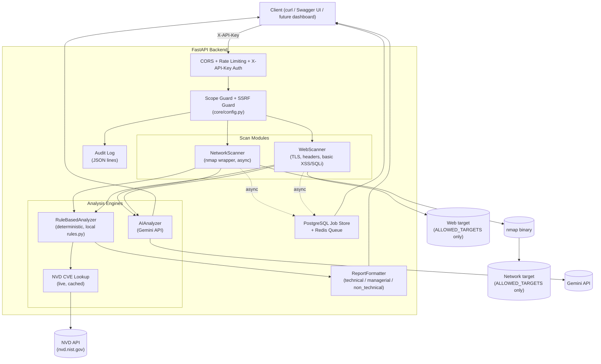

# AI-Powered Security Scanner

A backend security scanning platform built as a university thesis project: it
scans networks (via `nmap`) and websites (via `httpx`), then analyzes the
results through two independent engines — a Gemini-powered AI analyzer and a
fully deterministic, rule-based analyzer — and produces audience-specific
reports (technical / managerial / non-technical) from the same findings.

An Arabic version of this document is available at
[`README.ar.md`](./README.ar.md).

> **Scope note:** this is a portfolio / thesis project demonstrating secure
> API design, not a replacement for professional penetration-testing tools
> (Burp Suite, sqlmap, OWASP ZAP, Nessus, etc.). See
> [Limitations](#limitations) below.

## Table of contents

- [Architecture](#architecture)
- [Features](#features)
- [Quick start — Docker (recommended)](#quick-start--docker-recommended)
- [Frontend (bilingual dashboard)](#frontend-bilingual-dashboard)
- [Quick start — local venv (alternative)](#quick-start--local-venv-alternative)
- [API endpoints](#api-endpoints)
- [Example requests](#example-requests)
- [Security Considerations](#security-considerations)
- [Testing & CI](#testing--ci)
- [Project structure](#project-structure)
- [Limitations](#limitations)

## Architecture



**Design decision — two independent analysis engines:** the AI engine
(Gemini) gives deep, context-aware analysis but is non-deterministic and
costs an API call per run. The rule-based engine is 100% deterministic, free,
instant, and fully explainable (every classification traces back to one line
in `rules.py`) — but only catches what's explicitly encoded. `/analysis/compare`
runs both side by side; if the AI engine fails (e.g. no API key configured),
the rule-based report is still returned.

## Features

- **Network scanning** — async `nmap` wrapper (`basic` = top 1000 ports,
  `comprehensive` = all 65535), parses XML output into a unified JSON schema.
- **Web scanning** — TLS/certificate inspection, standard security header
  checks (CSP, HSTS, X-Frame-Options, etc.), and basic reflected-XSS /
  error-based-SQLi probes (only when the URL has query parameters).
- **AI analysis** — sends structured scan findings to Gemini, gets back a
  prioritized, explained report.
- **Rule-based analysis** — a fully local, deterministic alternative engine;
  no external API, no cost, fully traceable.
- **Audience-aware reports** — the same findings rendered three ways
  (`technical`, `managerial`, `non_technical`) from one shared source of
  truth (`rules.py`).
- **Live CVE lookup** — `POST /analysis/cve-lookup` queries the real NVD
  database for a given product/version, with local caching.
- **Background scans** — `POST /*/scan/async` + `GET /scans/{id}/status` for
  long-running full scans, so a client isn't blocked waiting minutes.
- **API security** — `X-API-Key` auth, CORS, per-key rate limiting, SSRF
  protection independent of scope config, and audit logging. See
  [Security Considerations](#security-considerations).

## Quick start — Docker (recommended)

```bash
git clone <this-repo>
cd security-scanner

cp backend/.env.example backend/.env
# edit backend/.env: set ALLOWED_TARGETS to your own lab targets only,
# and set API_KEY to a generated secret (see comment in .env.example)

cp frontend/.env.example frontend/.env
# edit frontend/.env: VITE_API_KEY must match backend/.env's API_KEY

docker compose up --build
```

The API is now at `http://localhost:8000` — interactive docs at
`http://localhost:8000/docs`. The dashboard is at `http://localhost:5173`.

> **Note on this repo's testing:** the Docker setup was built and reviewed
> carefully (nmap install, `setcap` for `-O` OS-detection capabilities,
> non-root user, healthcheck), but the environment used to build this
> project did not have a Docker daemon available to run `docker compose up`
> end-to-end. **Please verify it runs cleanly in your environment before
> relying on it** — if something doesn't come up, check `docker compose logs
> backend` first.

## Frontend (bilingual dashboard)

`frontend/` is a React + TypeScript dashboard (Vite) for running scans and
viewing analysis reports without touching `curl`/Swagger directly. It talks
to the backend over the `/api/v1` endpoints described below.

- Bilingual UI and reports: every analysis endpoint accepts a `language`
  field (`"ar"` or `"en"`, default `"ar"`) that controls the language of the
  *generated report content* itself (finding titles, descriptions,
  remediation, executive summary — including the AI engine's Gemini prompt).
  Severity classification and logic are identical in both languages; only
  the text differs. The dashboard's own UI chrome is switchable
  independently via `frontend/src/i18n/`.
- Talks to the backend's `X-API-Key`-protected endpoints — set
  `VITE_API_KEY` in `frontend/.env` to the same value as the backend's
  `API_KEY` (see `frontend/.env.example`).

Run it standalone (outside Docker) with:

```bash
cd frontend
npm install
cp .env.example .env       # set VITE_API_BASE_URL / VITE_API_KEY
npm run dev
```

Then open `http://127.0.0.1:5173` (make sure the backend is running first).

## Quick start — local venv (alternative)

### Requirements

- Python 3.11+
- `nmap` installed on the system (`sudo apt install nmap` on Ubuntu/Debian,
  `brew install nmap` on macOS)
- root/sudo privileges for full OS fingerprinting (`-O`) — without them the
  scan still runs, but `os_matches` may come back empty

### Steps

```bash
cd backend
python3 -m venv venv
source venv/bin/activate          # Windows: venv\Scripts\activate
pip install -r requirements.txt

cp .env.example .env
# edit ALLOWED_TARGETS and API_KEY in .env
# never add a target outside your own lab without explicit written authorization

uvicorn app.main:app --reload
```

Then open `http://127.0.0.1:8000/docs`.

## API endpoints

All endpoints below (except `/health`) require an `X-API-Key` header once
`API_KEY` is set in `.env`. Without it set, auth is disabled for local
development only (a startup warning is printed).

| Method | Path | Description |
|---|---|---|
| GET | `/health` | Liveness check, no auth required |
| POST | `/api/v1/network/scan` | Synchronous network scan |
| POST | `/api/v1/network/scan/async` | Start a network scan as a background task → `202` + `scan_id` |
| POST | `/api/v1/web/scan` | Synchronous web scan |
| POST | `/api/v1/web/scan/async` | Start a web scan as a background task → `202` + `scan_id` |
| GET | `/api/v1/scans/{scan_id}/status` | Poll status of an async scan (`pending`/`running`/`completed`/`failed`) |
| POST | `/api/v1/analysis/run` | AI analysis (requires `GEMINI_API_KEY`) |
| POST | `/api/v1/analysis/rule-based/run` | Deterministic rule-based analysis, raw findings |
| POST | `/api/v1/analysis/rule-based/report` | One formatted report for a given `audience` |
| POST | `/api/v1/analysis/rule-based/report/all` | All three audience reports at once |
| POST | `/api/v1/analysis/compare` | Runs AI + rule-based side by side |
| POST | `/api/v1/analysis/cve-lookup` | Live CVE lookup via NVD for a product/version |

`scan_type` for network scans accepts `discovery`, `quick`, `balanced`, `comprehensive`, `udp`, `vulnerability`, `deep`, or `maximum`. Use the `/async` variant for long-running profiles.

All `/api/v1/analysis/*` endpoints except `/cve-lookup` accept an optional
`language` field (`"ar"` default, or `"en"`) that controls the language of
the generated report text (titles, descriptions, remediation, executive
summary) — not the classification logic, which is identical either way.

## Example requests

```bash
# Network scan
curl -X POST http://127.0.0.1:8000/api/v1/network/scan \
  -H "Content-Type: application/json" -H "X-API-Key: $API_KEY" \
  -d '{"target": "127.0.0.1", "scan_type": "quick"}'

# Async full scan + poll status
SCAN_ID=$(curl -s -X POST http://127.0.0.1:8000/api/v1/network/scan/async \
  -H "Content-Type: application/json" -H "X-API-Key: $API_KEY" \
  -d '{"target": "127.0.0.1", "scan_type": "comprehensive"}' | jq -r .scan_id)

curl -H "X-API-Key: $API_KEY" http://127.0.0.1:8000/api/v1/scans/$SCAN_ID/status

# Web scan (add query params to enable basic XSS/SQLi probes)
curl -X POST http://127.0.0.1:8000/api/v1/web/scan \
  -H "Content-Type: application/json" -H "X-API-Key: $API_KEY" \
  -d '{"target": "https://target-in-scope.local/search?id=1"}'

# Rule-based analysis (no external API key needed)
NETWORK_RESULT=$(curl -s -X POST http://127.0.0.1:8000/api/v1/network/scan \
  -H "Content-Type: application/json" -H "X-API-Key: $API_KEY" \
  -d '{"target": "127.0.0.1", "scan_type": "quick"}')

curl -X POST http://127.0.0.1:8000/api/v1/analysis/rule-based/run \
  -H "Content-Type: application/json" -H "X-API-Key: $API_KEY" \
  -d "{\"network_scan\": $NETWORK_RESULT}"

# Non-technical report for a manager/non-technical stakeholder
curl -X POST http://127.0.0.1:8000/api/v1/analysis/rule-based/report \
  -H "Content-Type: application/json" -H "X-API-Key: $API_KEY" \
  -d "{\"network_scan\": $NETWORK_RESULT, \"audience\": \"non_technical\"}"

# Live CVE lookup
curl -X POST http://127.0.0.1:8000/api/v1/analysis/cve-lookup \
  -H "Content-Type: application/json" -H "X-API-Key: $API_KEY" \
  -d '{"product": "vsftpd", "version": "2.3.4"}'
```

## Security Considerations

This section documents the security posture of **the scanner tool itself** —
deliberately, since a security tool that isn't secure itself is a
contradiction worth calling out explicitly.

- **Scope Authorization Guard** (`core/config.py`) — every scan target is
  checked against `ALLOWED_TARGETS` (exact IP/hostname, or CIDR range)
  before any scan runs. This is the primary legal/ethical safeguard: the
  tool refuses to scan anything not explicitly authorized. **Never widen
  `ALLOWED_TARGETS` to include targets you don't have explicit written
  authorization to scan.**
- **SSRF protection** — independent of `ALLOWED_TARGETS`. Even if a
  dangerous address (cloud metadata endpoint `169.254.169.254`, multicast,
  reserved ranges, etc.) were accidentally added to the allowlist, this
  layer still blocks it. Hostnames are resolved before this check, to
  prevent DNS-rebinding bypasses. Can only be disabled via an explicit
  `ALLOW_SSRF_RISK_TARGETS=true` flag, intended only for documented lab
  scenarios.
- **API key authentication** — `X-API-Key` header, required on all
  scan/analysis endpoints once `API_KEY` is set. In production
  (`ENVIRONMENT=production`), the app refuses to start without one
  (fail-closed).
- **Rate limiting** — per-API-key (falling back to per-IP), configurable via
  `RATE_LIMIT_PER_MINUTE`, prevents a single client from exhausting scan
  resources or AI API budget.
- **CORS** — explicit allowlist via `CORS_ORIGINS`; the app refuses to start
  in production with `CORS_ORIGINS=*`.
- **Audit logging** — every scan request (target, scan type, timestamp,
  scope-check result) is written as JSON lines to `data/audit.log.jsonl`.
  **The API key itself is never logged.**
- **Command execution safety** — `nmap` is invoked via
  `asyncio.create_subprocess_exec` with an explicit argv list, never through
  a shell (no `shell=True`, no `os.system`) — so shell injection isn't
  possible through this path regardless of target content.
- **Known limitation — `KNOWN_VULNERABLE_VERSIONS`** — the small,
  hand-curated CVE table used by the deterministic rule-based engine
  (`rules.py`) is a **demo-scale set, not a comprehensive vulnerability
  database.** For a real/current CVE lookup, use the separate
  `POST /analysis/cve-lookup` endpoint, which queries the live NVD API.
- **Dependency scanning** — `pip-audit` (backend) and `npm audit` (frontend)
  run in CI on every push and fail the build on any known high/critical
  vulnerability in a pinned dependency.
- **Constant-time API key comparison** — `verify_api_key` uses
  `secrets.compare_digest` rather than `!=`, so response timing doesn't leak
  how much of a guessed key is correct.
- **Configurable TLS verification for web scans** — `WEB_SCAN_VERIFY_TLS`
  (default `false`, since lab/pentest targets often use self-signed certs)
  controls whether the *scan request itself* verifies the target's TLS
  certificate. This is independent from `_check_tls()`, which always
  reports the target's actual certificate validity regardless of this
  setting. Set to `true` if your targets have trusted CA certs and you want
  MITM protection on the scan channel too.
- **`VITE_API_KEY` is not a real secret** — any `VITE_`-prefixed env var is
  baked verbatim into the built JS bundle and is visible to anyone with
  DevTools access. It prevents accidental cross-origin calls, not access by
  an untrusted user of the frontend itself. Fine for a small trusted team
  tool; not sufficient for a multi-tenant deployment.

See **[SECURITY.md](./SECURITY.md)** for the full write-up of these points,
including the data-flow implications of sending scan data to the Gemini
API for AI analysis, and known limitations of the in-memory scan store.

## Testing & CI

```bash
cd backend
pip install -r requirements.txt -r requirements-dev.txt
pytest tests/ -v --cov=app --cov-report=term-missing
ruff check app/ tests/
mypy app/ --ignore-missing-imports
pip-audit -r requirements.txt
```

Current status (last verified locally): **100 tests passing, 93% coverage**
(threshold enforced at 75% in CI), `ruff` and `mypy` clean across the whole
`app/` tree, zero known vulnerabilities in pinned dependencies.

GitHub Actions (`.github/workflows/ci.yml`) runs all of the above — lint,
type-check, dependency audit, then tests with coverage — on every push and
pull request.

## Project structure

```
backend/
  app/
    core/
      config.py          # Settings, Scope Guard, SSRF Guard
      security.py         # X-API-Key auth dependency
      rate_limit.py        # slowapi rate limiting
      audit_log.py          # JSON-lines audit logging
      scan_store.py          # In-memory async scan status store
    schemas/
      network.py, web.py, analysis.py   # Pydantic models
    modules/
      network_scan/scanner.py    # nmap wrapper (async)
      web_scan/scanner.py         # TLS + headers + basic vuln checks (async)
      ai_analysis/analyzer.py      # Gemini API integration
      rule_based_analysis/
        rules.py                    # Static classification rules
        analyzer.py                  # Deterministic analysis logic
        report_formatter.py           # technical/managerial/non_technical reports
        nvd_client.py                  # Live NVD CVE lookup (cached)
    api/routes/
      network.py, web.py, scans.py, analysis.py
    main.py                # FastAPI app entrypoint
  tests/
    unit/                  # Per-module tests, external calls mocked
    integration/            # TestClient-based API endpoint tests
  Dockerfile, .dockerignore
  requirements.txt, requirements-dev.txt
  .env.example
frontend/
  src/
    api/client.ts           # Backend HTTP client (X-API-Key, language field)
    components/              # Scan controls, report/comparison views
    i18n/                     # UI string bilingual (AR/EN) support
  Dockerfile, .dockerignore
  package.json
  .env.example
docker-compose.yml
.github/workflows/ci.yml
```

## Limitations

- This tool performs **basic** checks. It is not a substitute for
  professional penetration-testing tools or a licensed security audit.
- The basic XSS/SQLi probes in the web scanner are intentionally simple
  (unescaped-reflection and error-signature checks) — they can produce
  false positives/negatives. Any positive result needs manual verification
  before being reported as a confirmed finding.
- The rule-based engine's `KNOWN_VULNERABLE_VERSIONS` table is a small,
  manually curated demo set (see [Security Considerations](#security-considerations))
  — use `/analysis/cve-lookup` for real CVE coverage.
- Async scan status is stored **in memory only** — it's lost on process
  restart and doesn't work across multiple horizontally-scaled instances.
  A move to SQLite/Redis is the natural next step if this becomes a real
  multi-instance service.
- The AI analysis engine (`/analysis/run`) requires a valid
  `GEMINI_API_KEY` and was tested end-to-end for its request-building
  and response-parsing logic with the real API call mocked; verify actual
  Gemini API connectivity with your own key before relying on it.
- Docker was built carefully but could not be run end-to-end in the
  environment this project was developed in (no Docker daemon available) —
  verify `docker compose up` in your own environment.

## API Security Engine

The Web Security layer now includes a dedicated API Security engine:
- OpenAPI/Swagger discovery and JSON/YAML parsing.
- Endpoint and operation inventory with OpenAPI security requirements.
- GraphQL endpoint discovery with optional read-only introspection.
- Safe HTTP method matrix using OPTIONS/HEAD/GET by default.
- Optional explicit probing of write methods; disabled by default.
- Optional Authorization/Cookie context for session-aware comparison; secrets are not returned in scan results.
- Local JSON template packs under `backend/app/modules/api_security/templates/` and runtime packs under `backend/data/api_templates/`.
- API findings are forwarded to the Gemini analysis layer as structured evidence.

API endpoint: `POST /api/v1/api-security/scan`.

### API template packs

Template packs can be inspected or refreshed through:
- `GET /api/v1/api-security/templates`
- `POST /api/v1/api-security/templates/import`
- `POST /api/v1/api-security/templates/reload`

Template packs should contain no secrets and should describe passive/safe checks or explicitly authorized checks only.

## Unified Monster Architecture

The project now exposes a unified `/api/v1/platform` orchestration layer:

`Dashboard -> Scan Manager -> Network/Web/API -> Normalizer -> Risk Engine -> Rule/Gemini -> Correlator -> Report Generator`

It also maintains an asset inventory and adds DNS/TLS/JavaScript intelligence, scan comparison, SARIF/HTML/Markdown export, background full scans, authentication-aware HTTP discovery, OpenAPI/GraphQL analysis and template-driven checks. Network targets are derived from URLs for combined assessments, while Web/API engines retain SSRF protection and never persist bearer tokens or cookies.

## Job Manager (Phase 2)

Full platform scans can be started asynchronously with `POST /api/v1/platform/scan/async`.
The returned `job_id` is also the legacy `scan_id` so existing clients continue to work.

Lifecycle endpoints:

- `GET /api/v1/jobs/{job_id}` — progress, current engine, duration, logs and result.
- `POST /api/v1/jobs/{job_id}/pause` — cooperative pause at engine checkpoints.
- `POST /api/v1/jobs/{job_id}/resume` — resume a paused job.
- `POST /api/v1/jobs/{job_id}/cancel` — cancel the running job.
- `GET /api/v1/scans/{scan_id}/status` — backwards-compatible status endpoint.

Pause/resume is intentionally cooperative: a scanner engine that is already executing is allowed to finish its current engine step before the next checkpoint. Credentials are never included in job logs or snapshots.

## Phase 2 complete feature set

- Asynchronous full-scan jobs with progress, engine, logs, pause/resume/cancel.
- Persistent asset inventory and scan comparison.
- Explicit authentication comparison via `POST /api/v1/analysis/auth-compare`.
- Report formats: Markdown, HTML, JSON, CSV, SARIF, PDF.
- CI gate: `python scripts/ci_scan.py --target https://test.example.com`.
- Continuous schedules: `POST/GET/DELETE /api/v1/continuous/schedules` (minimum interval 5 minutes).
- Safe in-process plugin registry; writable directories are never auto-imported as Python code.
- Secrets remain request-scoped and are not persisted into scan results or AI candidates.

Run the complete local verification with `scripts/run_full_checks.ps1` on Windows or the equivalent commands in the CI workflow.

## Production deployment architecture

The Phase 2 deployment now supports:

```text
Reverse Proxy / HTTPS
        |
      FastAPI
        |
   Redis queue ---- PostgreSQL
        |
     Worker(s)
        |
 Network / Web / API scanners
```

`POST /api/v1/platform/scan/async` creates a durable job. With `REDIS_URL` configured, the API enqueues the job and a separate `worker` executes it. Job state is persisted in PostgreSQL, so an API restart does not erase queued/completed job metadata.

For a local development run, Redis can be omitted and async jobs use FastAPI background execution as a compatibility fallback. This fallback is not a horizontal-scaling design.

### Release requirements

1. Copy `backend/.env.example` to `backend/.env` and generate new secrets.
2. Set `ENVIRONMENT=production`, `ENFORCE_TARGET_SCOPE=true`, and a minimal `ALLOWED_TARGETS` list.
3. Set `POSTGRES_PASSWORD`, `API_KEY`, exact `CORS_ORIGINS`, and (if AI is enabled) `GEMINI_API_KEY`.
4. Keep PostgreSQL and Redis private; expose only the HTTPS reverse proxy and frontend.
5. Run `docker compose up --build -d`.
6. Confirm `/health` and `/readiness` before accepting scans.
7. Run `PRODUCTION_CHECKLIST.md` before release.

### Important authentication boundary

The existing dashboard intentionally keeps its current visual design and uses the existing API-key flow. A Vite `VITE_API_KEY` is **not a browser secret**. Therefore this release is appropriate for an authorized internal deployment, but it should not be presented as a public multi-tenant SaaS. Public/multi-tenant release requires a real user/session authentication flow and PostgreSQL tenant isolation/RLS.


## Admin Control Center

When Supabase Auth is enabled, the first auto-provisioned identity for a new tenant is assigned
the `owner` role. Subsequent users are provisioned according to their `app_metadata.role` claim.

The backend `/api/v1/admin/*` endpoints are protected server-side with RBAC and tenant context.
Admins can manage viewer/analyst accounts; owners can manage privileged accounts except transferring
ownership. Role/status changes are audited and, when `SUPABASE_SERVICE_ROLE_KEY` is configured,
mirrored to Supabase `app_metadata` by the backend. The service-role key must never be exposed to
the frontend or any `VITE_*` variable.

The database role is authoritative after provisioning, so a stale JWT claim cannot silently restore
a revoked role. Disabled users are rejected by the backend even if an old access token exists.


## Admin Security Center
See `ADMIN_SECURITY_CENTER.md` for RBAC, policies, sessions, API keys, feature flags, health, backup status and RLS details.

## Production deployment

For a Supabase + Redis + durable worker production deployment, see `DEPLOYMENT_PRODUCTION.md` and use `docker-compose.production.yml`. The production frontend is built as static assets and served by Nginx; `/api/*`, `/health`, and `/readiness` are proxied to FastAPI. Do not expose PostgreSQL or Redis publicly.
